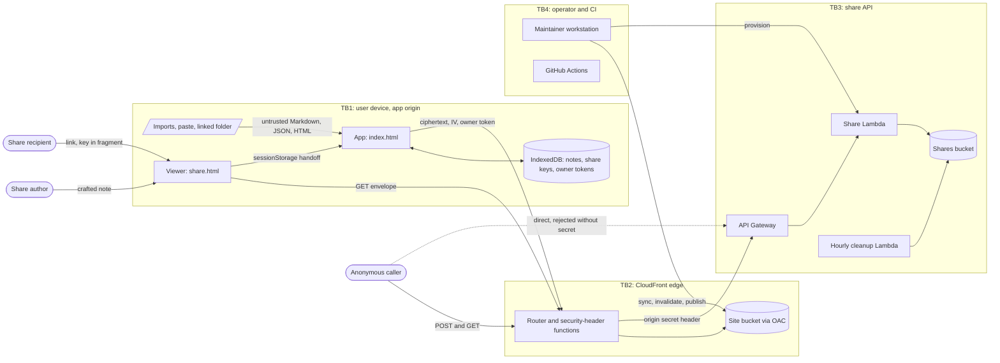

# Scratchpad threat model

| Field | Value |
| --- | --- |
| Scope | Full service: browser app, share viewer, share API, CloudFront edge, operator scripts, and CI |
| Code revision | `bee64b8`, main at v4.6.0 (this model's branch changes no app or infrastructure code) |
| Date | 2026-10-15 |
| Status | First draft for Threat Management review |
| Related | `.oss-scanner/threat_model.md` (scanner brief and severity rubric) |

## Summary

Scratchpad keeps notes in the browser and uploads nothing unless the user shares a note. A share is AES-GCM ciphertext whose key rides in the link's fragment, which browsers never send. Risk concentrates in two places: the browser origin, where sender-controlled Markdown renders beside every note and share credential the visitor holds, and the anonymous share API.

The share API is in good shape, and its 85 unit tests pass. The top residual risks are a sanitizer bypass on the same-origin viewer (F1), an unasserted deploy identity (F2), and storage-cost abuse of the write endpoint (F3). No finding rates High residual, so nothing goes to ERMC yet. F2 becomes High if open question 1 comes back yes.

## Assets

| Asset | Where it lives | EW tier |
| --- | --- | --- |
| Note content: titles, bodies, tags, revisions, image attachments | IndexedDB; JSON and ZIP backups; linked-folder `.md` files | Confidential |
| Share key, 256-bit AES-GCM | Link fragment; the owner's IndexedDB `shares` store (`public/js/share-manager.js:90`) | Restricted |
| Share owner token | The owner's IndexedDB (`share-manager.js:91`); the server keeps only its SHA-256 | Restricted |
| Share object: ciphertext, IV, expiry, revision, token hash | Private S3 bucket under `shares/` | General Business Use |
| Encrypted backup file | Wherever the user saves it (PBKDF2, 600,000 iterations, `public/js/crypto.js:8`) | Confidential |
| Origin secret | Lambda environment and the CloudFront origin's custom header | Restricted |
| AWS deploy and admin credentials | Maintainer workstation | Restricted |
| `CLAUDE_CODE_OAUTH_TOKEN` | GitHub Actions secrets | Restricted |
| Static app code and header config | Site bucket behind OAC; `cloudfront/` | Public |

Users can paste anything into a note, passwords included. The app can't classify content, so note content is Confidential here. The same IndexedDB holds Restricted share credentials, so any script running on the app origin has High impact.

## Actors

The note owner trusts their own device. A share recipient holds a link and should read that one note only. A malicious share author controls every byte of a shared note. An anonymous caller reaches `/api/share` through CloudFront and can reach API Gateway directly. Local software can rewrite linked-folder files. The maintainer holds AWS credentials, and GitHub users open the issues and PRs that CI reads.

## Data flows and trust boundaries

`gha` holds a secret but no deploy rights, so it has no edge into the service.

## STRIDE by boundary

| ID | Boundary | STRIDE | Threat | Controls credited | Finding |
| --- | --- | --- | --- | --- | --- |
| T1 | TB1 | T, E | Script injection from a shared note's Markdown, in the viewer or after Save to my Scratchpad | C1, C2 | F1 |
| T2 | TB1 | I | A shared note loads remote images to track the reader | C1 strips remote `src`; C2 `img-src` | None |
| T3 | TB1 | T, D | A crafted backup, Markdown file, or linked-folder file corrupts notes or exhausts the tab | C10, partial | F9 |
| T4 | TB2 | I | Share key or plaintext leaves the browser | C3, C4 | F4 |
| T5 | TB2 | T | Framing, downgrade, or a response missing its headers | C2, C9 | F6 |
| T6 | TB2 | T | Service worker caches attacker content or a revoked share | C11 | None |
| T7 | TB3 | S | Caller skips CloudFront by calling API Gateway directly | C7 | F5 |
| T8 | TB3 | T, E | Caller changes or deletes another person's share | C6 | None |
| T9 | TB3 | T | Caller persists extra fields or extends expiry | C5 | None |
| T10 | TB3 | D | Anonymous floods fill storage or block share creation | C12 | F3 |
| T11 | TB3 | R | Owner revoke or update can't be attributed | None, by design | F8 |
| T12 | TB3 | I | Expired or revoked share stays readable | C8 | None |
| T13 | TB3 | E | Lambda role reaches beyond share objects | C13 | None |
| T14 | TB4 | S, E | A deploy runs as an over-privileged identity | Scoped deploy user (`CLAUDE.md`) | F2 |
| T15 | TB4 | T | Tampered dependency or CI plugin | C14 | F7 |

Three generic entries don't apply. Injection: no database or shell sits on the request path, and S3 keys come from a validated 12-character ID. CSRF: no cookies or ambient credentials exist, and owner actions need a header token. Session hijack: there are no accounts.

## Existing controls

| ID | Control | Location | Key | Verified |
| --- | --- | --- | --- | --- |
| C1 | DOMPurify with closed tags, no `style`, a scheme allowlist, then remote `src` stripping and `noopener noreferrer` | `public/js/markdown.js:5-24`, `:125-140`, `:300-309` | Key | Yes, `sanitization.spec.js` passed |
| C2 | CSP `script-src 'self'` plus three hashes, `frame-ancestors 'none'`, HSTS preload, `nosniff` | `cloudfront/security-headers-function.js:16-31` | Key | Code read; live headers not checked |
| C3 | Random 256-bit key, fresh 96-bit IV per encryption | `crypto.js:98-131` | Key | Code read |
| C4 | Zero-request contract; viewer fetch omits credentials and referrer | `tests/network-isolation.spec.js`; `public/js/share.js:121-125` | Key | Yes, passed |
| C5 | 256 KB cap; only `v`, `ciphertext`, `iv` persist; server owns expiry | `share-infra/lambda/validate.mjs:62-104`; `update.mjs:43-52` | Key | Yes, Lambda tests |
| C6 | 72-bit IDs; 256-bit owner token stored as SHA-256 and compared in constant time; revision and ETag preconditions | `handler.mjs:24-35`, `:121-128`; `update.mjs:12-17`, `:83-87`; `s3-store.mjs:48-59` | Key | Yes, Lambda tests |
| C7 | Origin secret checked in constant time | `handler.mjs:41-54` | Key | Code read; CloudFront header not checked |
| C8 | Expiry on read, in the viewer, by tag lifecycle with a 30-day backstop, and by hourly cleanup; updates refused on a versioned bucket | `handler.mjs:117`; `share.js:154-157`; `share-infra/lifecycle.json`; `cleanup.mjs`; `provision-updates.sh:98-100` | Key | Code tested; live lifecycle not checked |
| C9 | Unknown paths rewritten to `index.html` so headers apply | `cloudfront/share-router-function.js:54-73` | Key | Code read |
| C10 | Import caps and attachment type allowlist; files that pass `isNativeBackup` skip the caps (F9) | `public/js/app.js:13-23`, `:4720-4724`; `public/js/attachments.js:10` | Non-key | Code read |
| C11 | Worker caches same-origin shell GETs only; `/api/share` passes through | `public/service-worker.js:140-190` | Non-key | Code read |
| C12 | 20 req/s throttle, reserved concurrency of 25, invocation and cost alarms | `share-infra/README.md` section 8 | Non-key | No, live config |
| C13 | API role limited to four object actions on `shares/*`, no list | `share-infra/iam-policy.json` | Key | File read; live role not checked |
| C14 | SHA-pinned actions, read-only tokens, `author_association` gate, weekly vendor check | `.github/workflows/claude.yml:20-26`; `vendor-currency.yml` | Non-key | Code read |

A grep of the app's own scripts in `public/js`, vendor files excluded, found no `innerHTML`, `insertAdjacentHTML`, `document.write`, or `eval` sinks.

## Findings

| ID | Finding | Location | Inherent | Residual | Treatment |
| --- | --- | --- | --- | --- | --- |
| F1 | Script injection in a shared note would reach the whole app origin | `share.html`; `markdown.js:175-215`, `:300-309`; `shared-copy.js:96-112` | High | Medium | Mitigation |
| F2 | `deploy.sh` checks that credentials work, not whose they are | `deploy.sh:76` | High | Medium | Mitigation |
| F3 | Anonymous writes can run up storage cost | `POST /api/share`; `validate.mjs:5`; `share-infra/README.md` resource table and section 8 | Medium | Medium | Mitigation |
| F4 | A share link is a bearer credential for up to 30 days | `crypto.js:98-120`; `share.js:49-52` | High | Medium | Acceptance |
| F5 | The origin-secret check passes every request when the secret is unset | `handler.mjs:42` | Medium | Low | Mitigation |
| F6 | Missing `/public/*` objects return S3's 403 with no security headers | `share-router-function.js:67-69` | Low | Low | Acceptance |
| F7 | The review workflow loads an unpinned plugin marketplace beside the OAuth secret | `.github/workflows/claude-code-review.yml:38-45` | Low | Low | Acceptance |
| F8 | Revoke and update leave no audit trail | `handler.mjs:152-153` | Low | Low | Acceptance |
| F9 | A file that claims to be a native backup skips the import caps | `app.js:4720-4724`, `:5081`, `:5120`, `:5144`; `attachments.js:235-258` | Low | Low | Mitigation |

F1. The viewer shares the app's origin, so script there can read every note, share key, and owner token in the visitor's IndexedDB. C1 and C2 are independent layers, and C1 is tested. The custom `marked` renderers still build HTML strings before sanitizing, and each new renderer widens that surface. Serving the viewer from its own origin would confine a bypass to a page that holds no notes. Saving would then need an explicit cross-origin handoff.

F2. `CLAUDE.md` records that without `AWS_PROFILE` the script runs as the default profile, an account administrator. Have `deploy.sh` compare the caller ARN with the expected deploy principal and stop on a mismatch. Gate the admin key with MFA or retire it.

F3. Bodies up to 256 KB are accepted, and the WAF body-size rule runs in Count mode. At the documented 20 req/s, maximum-size bodies would add about 450 GB a day, roughly 14 TB at 30 days of retention (an estimate). Alarms detect this, but nothing limits a single client, and the stage-wide throttle lets a flood block real users too. The README's next step, a WAF rate-based rule on `/api/share`, would add that limit.

F4. Anyone holding the full link reads the note until it expires or the owner revokes it. Links persist in chat logs and synced browser history. This is inherent to link sharing, and the share dialog already tells the owner that anyone with the link can read and forward it (`index.html:1113`).

F5. Both provisioning scripts set the secret, and `provision-updates.sh:56-57` refuses to enable updates without it. Failing closed in deployed code, with an explicit local-only bypass, removes the misconfiguration path.

F9. `isNativeBackup` trusts a file's own `app` and `schemaVersion` fields. A crafted file therefore skips the 2 MB file cap, the note and revision counts, and the text-length checks. Its attachment bytes also decode with no size bound. The exemption exists so a real full-library backup restores. The harm stays in the importing user's own tab, because existing notes change only if the user picks Replace in the import preview (`index.html:856-870`, `app.js:5218`). Capping each imported attachment at the 4 MB paste limit (`attachments.js:12`) closes the unbounded part without breaking real backups.

F6 to F8 need no change. The F6 body is an S3 error document with no app content. F7 is documented in the file, and fork PRs get no secrets on that trigger. F8 is a privacy choice: CloudFront access logs aren't available on the current plan, and takedown works by share ID (`share-infra/README.md` section 7).

## Assumptions and open questions

This review didn't verify the following:

- Live AWS configuration: throttling, reserved concurrency, alarms, Block Public Access, the WAF override, the CloudFront origin header, and lifecycle rules. Controls that depend on it say so.
- `.env.local`, which was deliberately not read, so whether it sets `AWS_PROFILE` is unknown.
- Firefox and WebKit. The browser specs ran on Chromium only, locally.
- Vendored `marked`, DOMPurify, and Prism versions against current advisories.
- The local `SECURITY-REVIEW.md`, which isn't in the working tree. Prior findings appear here only through `CLAUDE.md`.
- The classification rules. The skill's EW reference files were missing, so tiers follow the four names it defines without the detailed mapping.

The reviewer should answer these questions:

1. Is the workstation's default AWS profile still an administrator without MFA? A yes makes F2 High residual and an ERMC item.
2. Should the viewer move to its own origin (F1), given the Save to my Scratchpad handoff it would change?
3. Is F3 within appetite with alarms alone?
4. Is `SHARE_UPDATES_ENABLED` on in production? If it is, T12 depends on the hourly cleanup staying scheduled.

## Change log

| Date | Change |
| --- | --- |
| 2026-10-15 | First full-mode draft. |
| 2026-10-15 | Review fixes on PR #35: pinned the revision to `bee64b8`, narrowed C10, and added F9. |
